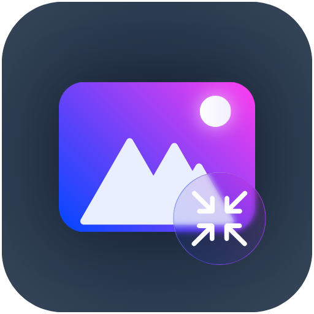

<p align="center">
  
</p>

<h1 align="center">Comprimi Immagini Rapido</h1>

<p align="center"><b>Meno peso, stessa foto.</b><br>
Comprimi, ridimensiona e ritaglia le tue immagini con un'anteprima prima/dopo in tempo reale.</p>

<p align="center">
  
  
  
</p>

---

## ✨ Cosa fa

- **Trascina e basta**: immagini o cartelle intere nella finestra (oppure **Aggiungi**, oppure **Ctrl+V** per incollare uno screenshot).
- **Anteprima prima/dopo**: una linea che si trascina divide l'originale dalla versione compressa. Sotto vedi peso prima → dopo e la percentuale risparmiata.
- **Quattro qualità pronte** (Minima, Leggera, Normale, Nitida) e un cursore per regolare la **qualità** a mano.
- **Prima di tutto l'immagine**: il pulsante a destra nell'intestazione (o `F`) nasconde l'elenco e lascia l'anteprima grande; **schermo intero** con `F11`.
- **Tre formati**: **JPEG** (foto, con [MozJPEG](https://github.com/mozilla/mozjpeg) se presente), **PNG** (senza perdita, con trasparenze) e **PNG 256** (256 colori, molto più leggero per screenshot e grafica). Si scelgono dalla tendina nella sezione **Altro**.
- **Sezione Altro** (chiusa di base, con un riassunto di ciò che hai scelto): **formato**, **Ridimensiona** (spenta di base: attiva il cursore della dimensione, così non si rimpicciolisce una foto per sbaglio), **Progressivo**, **Bianco e nero** e **Dettaglio colore** (Standard o Pieno) per il JPEG.
- **Ritaglio** direttamente sull'immagine, per ogni foto.
- **Comprimi tutto** con barra di avanzamento e riepilogo finale; **Salva**, **Copia file** e **Copia immagine** per una sola foto.
- **Foto del telefono raddrizzate** (legge l'orientamento EXIF) e **metadati rimossi** (niente posizione GPS nelle foto condivise).
- **Tema scuro e chiaro**, animazioni fluide, barra del titolo dello stesso colore della finestra.
- **Nessun file in giro**: impostazioni e log solo in `%APPDATA%\ComprimiImmaginiRapido`, nessun file temporaneo, gli originali non si toccano mai.

## 🚀 Download

1. Vai in **[Releases](../../releases)** e scarica `Comprimi-Immagini-Rapido-windows.zip`.
2. Estrai lo zip dove vuoi (Desktop, Download…).
3. Apri **`Comprimi Immagini Rapido.exe`**.

Non serve installare Java: è già dentro.

> **Windows SmartScreen** può avvisare che l'app non è riconosciuta, perché non è firmata. Premi **Ulteriori informazioni → Esegui comunque**. Accanto allo zip c'è il file `.sha256` per verificarne l'integrità.

## 🧭 Guida rapida

1. **Aggiungi** le immagini: trascinale nella finestra, premi *Aggiungi* o *Ctrl+V*.
2. **Scegli come comprimere**: *Minima*, *Leggera*, *Normale* o *Nitida*, oppure muovi il cursore della qualità. Formato, dimensione e le altre opzioni sono in *Altro*; per rimpicciolire anche la foto spunta *Ridimensiona*.
3. **Controlla** il risultato spostando la linea sull'anteprima.
4. **Salva**: *Comprimi tutto* per l'intero elenco, *Salva* per quella selezionata.

| Qualità | Qualità JPEG | Dimensione | Quando usarla |
|---|---|---|---|
| Minima | 50 | 30% | Chat e mail: file piccolissimi |
| Leggera | 65 | 50% | Siti e documenti |
| Normale | 75 | 75% | Va bene quasi sempre |
| Nitida | 90 | 100% | Meno peso senza rimpicciolire la foto |

Minima, Leggera e Normale accendono da sole *Ridimensiona*; Nitida la spegne. Il ridimensionamento si può sempre attivare o disattivare a mano con la spunta.

### Dove vanno i file

- **Cartella fissa** (di base `Documenti\Comprimi Immagini Rapido`, cambiabile in *Impostazioni*).
- **Accanto all'originale**: `nome_compressa.jpg` nella stessa cartella.

Non sovrascrive mai niente: se il nome esiste già aggiunge `_2`, `_3`… Rifare *Comprimi tutto* sulle stesse immagini aggiorna i file creati prima, senza duplicati.

### Scorciatoie

| Tasti | Azione |
|---|---|
| `Ctrl+O` | Aggiungi immagini |
| `Ctrl+V` | Incolla uno screenshot (o file copiati) |
| `Ctrl+S` | Salva l'immagine selezionata |
| `Ctrl+Invio` | Comprimi tutto |
| `Canc` | Toglie dall'elenco l'immagine selezionata |
| `↑` `↓` | Cambia immagine |
| `F` | Mostra solo l'immagine (nasconde/rimostra l'elenco) |
| `F11` | Schermo intero |
| `Esc` | Chiude la finestra aperta / esce dal ritaglio / esce dallo schermo intero |

Tutto questo è spiegato anche dentro il programma, nel pulsante **Guida**.

## 🔒 Privacy e file

- Tutto resta sul tuo PC: il programma non si collega a Internet e non invia nulla.
- Le impostazioni sono in `%APPDATA%\ComprimiImmaginiRapido\config.properties`, il log (limitato) in `log.txt`.
- Durante il lavoro non usa file temporanei. Se si chiude male, i resti vengono tolti al successivo avvio.
- Si apre una volta sola: se lo riavvii, porta in primo piano quello già aperto.

## 🛠️ Compilare da sorgente

Serve un **JDK 21** (con `jpackage`), per esempio [Temurin](https://adoptium.net).

```bat
build.bat
```

L'app pronta è in `out\Comprimi Immagini Rapido\`.

**Con GitHub Actions**: a ogni push su `main` il workflow costruisce l'app e la mette fra gli *artifact*. Per pubblicare una versione crea un tag:

```bash
git tag v1.0.0
git push origin v1.0.0
```

Lo zip e il suo `.sha256` vengono allegati alla Release in automatico.

**MozJPEG**: il workflow scarica il codice sorgente ufficiale (v4.1.1), compila `cjpeg.exe` e lo mette in `tools\` accanto al programma. In locale, se vuoi MozJPEG, metti il tuo `cjpeg.exe` in `vendor\` prima di lanciare `build.bat`. Senza, l'app usa il JPEG di Java e funziona uguale.

**Cambiare l'icona**: sostituisci `assets/icon.png` con un PNG quadrato (meglio 512×512). Il `.ico` viene creato da solo a ogni build (`tools/CreaIcona.java`).

## 📁 Struttura

```
Comprimi-Immagini-Rapido/
├── .github/workflows/build.yml     # build su Windows + Release con checksum
├── assets/icon.png                 # icona del programma
├── src/
│   ├── ComprimiImmaginiRapido.java # avvio
│   ├── Finestra.java               # finestra principale e logica
│   ├── Motore.java                 # lettura, EXIF, ridimensiona, ritaglia, JPEG/PNG
│   ├── Quantizza.java              # PNG a 256 colori
│   ├── Confronto.java              # anteprima prima/dopo e ritaglio
│   ├── Coda.java                   # elenco immagini e zona di trascinamento
│   ├── Pannelli.java               # Guida, Impostazioni, avanzamento, esito
│   ├── Controlli.java              # pulsanti, selettori, cursori, interruttori
│   ├── Scelta.java                 # tendina dei formati
│   ├── Anim.java                   # motore delle animazioni
│   ├── Gfx.java, Tema.java         # disegno, colori, font, logo
│   ├── Cfg.java                    # impostazioni, log, pulizia, istanza unica
│   ├── TitoloScuro.java            # colore barra del titolo (Windows)
│   └── Voce.java                   # un'immagine dell'elenco
├── tools/CreaIcona.java            # crea il .ico dal PNG
├── build.bat                       # build locale
├── LICENSE
└── README.md
```

## 🐞 Segnalazioni

Se qualcosa non va: **Impostazioni → Segnala un problema**. Il programma crea sul Desktop un file con i dati tecnici utili (versione, Windows, schermi, impostazioni, errori registrati), senza immagini né nomi delle tue cartelle. Puoi leggerlo e poi mandarlo a **domenico.castaldod29@gmail.com** con due righe su cosa stavi facendo. I report sul Desktop spariscono da soli dopo 14 giorni.

## 📄 Licenza

Rilasciato sotto licenza [MIT](LICENSE).

---

<p align="center">Fatto con ❤️ da <b>Domenico Castaldo</b></p>
